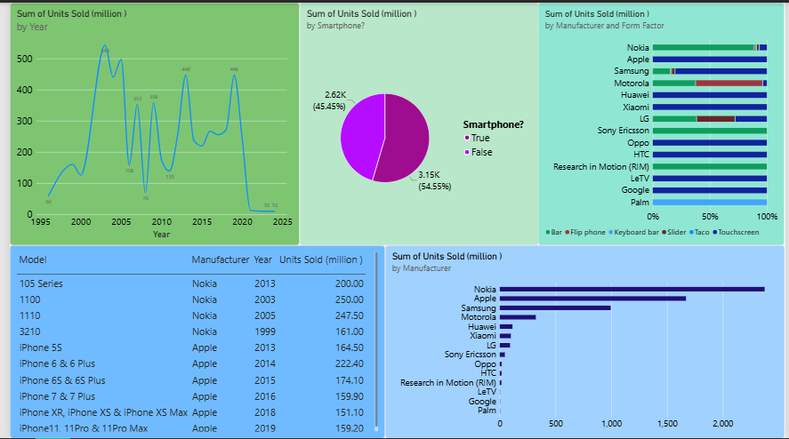

# Mobile Phone Sales Analysis (Python, SQL & Power BI)

An end-to-end data analytics project analysing the **Top 120 Best-Selling Mobile Phones** using **Python, SQL, and Power BI**. The project covers exploratory data analysis, hypothesis testing, predictive modeling, database querying, and interactive dashboarding on a single unified dataset.

## Tech Stack
* **Python:** Pandas, NumPy, Matplotlib, Seaborn, SciPy, Scikit-Learn (EDA, Welch's t-test, Correlation Heatmap, Linear Regression)
* **SQL:** Complex Queries, CTEs, Stored Functions, Window Functions (Moving Averages), Triggers
* **Power BI:** Data Modeling & Interactive Dashboarding

## Key Insights

### 1. Market & Manufacturer Performance
* **All-Time Leaders:** **Nokia** leads total historical sales (**2,374.5M**), followed by **Apple** (**1,669.3M**), **Samsung** (**994.5M**), **Motorola** (**323.0M**), and **Huawei** (**113.8M**).
* **Best-Selling Models:** The **Nokia 1100 (250M)**, **Nokia 1110 (247.5M)**, and **iPhone 6 & 6 Plus (222.4M)** top the all-time charts.
* **Sales Peaks:** Major volume spikes occurred in **2003 (543M)**, **2013 (448M)**, and **2019 (446M)**.
* **Form Factor Evolution:** Classic brands like Nokia and Motorola relied heavily on Bar and Flip phones, while Apple, Huawei, Xiaomi, and Oppo are exclusively Touchscreen.

### 2. Statistical & Predictive Findings (Python)
* **Smartphones vs. Non-Smartphones (Welch's t-test):** Non-smartphones averaged **74.87M** units sold per model compared to **37.01M** for smartphones ($t = -2.9613, p = 0.0047$), confirming a statistically significant difference in per-model sales volume.
* **Linear Regression (Year vs. Units Sold):** Predicting units sold solely from release year yielded an **$R^2$ of 0.1617** ($\text{MSE} = 3460.24$, slope $= -2.20$), showing a slight downward trend in peak single-model sales over time as the market fragmented across more brands.

## Power BI Dashboard


## Project Files
* `top 120 best-selling mobile phones.csv` — Unified dataset (120 records, 0 missing values)
* `mobile_sales_python_analysis.ipynb` — Python EDA, statistical testing, visualizations, and linear regression
* `mobile_sales_analysis.sql` — SQL Server queries, CTEs, stored functions, window functions, and triggers
* `MobileSaleDashboard.pbix` — Interactive Power BI report
* `Top-120_MobileSaleDashboard.png` — Dashboard preview image

## How to Use
1. Clone this repository:
   ```bash
   git clone [https://github.com/rumul-mazumdar/Mobile-Phone-Sales-Analysis.git](https://github.com/rumul-mazumdar/Mobile-Phone-Sales-Analysis.git)
## Author
**Rumul Hussain Mazumdar**  
GitHub: [@rumul-mazumdar](https://github.com/rumul-mazumdar)
